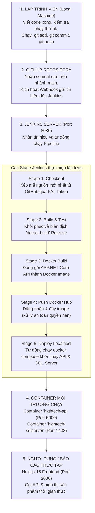

# SỔ TAY HƯỚNG DẪN TRIỂN KHAI CI/CD VỚI JENKINS + DOCKER + GITHUB
## DỰ ÁN HIGHTECH SPORTS (ĐỒ ÁN LẬP TRÌNH WEB 1 - ĐẠI HỌC ĐÔNG Á)

> **Tài liệu hướng dẫn thực chiến:** Bao gồm toàn bộ quy trình thiết lập, vận hành, kiểm thử trên môi trường **Localhost (máy cá nhân)** và phương án mở rộng lên **VPS Production từ xa**.

---

## 1. TỔNG QUAN QUY TRÌNH TỰ ĐỘNG HÓA CI/CD

Quy trình tự động hóa hoạt động liên hoàn theo 5 giai đoạn:



---

## 2. CÁC ĐƯỜNG DẪN KIỂM THỬ HỆ THỐNG SAU KHI DEPLOY

Sau khi Jenkins Pipeline báo **`Finished: SUCCESS`**, toàn bộ dịch vụ đã sẵn sàng phục vụ:

| Thành phần | Đường dẫn (URL) | Mô tả & Cách kiểm tra |
|---|---|---|
| **Swagger UI API** | [http://localhost:5000/swagger](http://localhost:5000/swagger) | Giao diện tài liệu tương tác toàn bộ API (Products, Categories, Orders, Auth, Vouchers) |
| **Health Check API** | [http://localhost:5000/health](http://localhost:5000/health) | Trả về `{"status":"healthy","timestamp":"..."}` |
| **Dữ liệu Sản phẩm** | [http://localhost:5000/api/products](http://localhost:5000/api/products) | Trả về danh sách 8 sản phẩm thể thao được seed tự động từ SQL Server |
| **Frontend Website** | [http://localhost:3000](http://localhost:3000) | Giao diện người dùng mua sắm Next.js (chạy qua lệnh `npm run dev`) |
| **Trang Admin Web** | [http://localhost:3000/admin](http://localhost:3000/admin) | Dashboard thống kê doanh thu, quản lý đơn hàng & sản phẩm |
| **Jenkins Dashboard** | [http://localhost:8080](http://localhost:8080) | Giao diện quản trị CI/CD theo dõi tiến trình build |

---

## 3. CHI TIẾT CÁC GIAI ĐOẠN TRONG JENKINSFILE

Mã nguồn `Jenkinsfile` được chuẩn hóa như sau:

```groovy
pipeline {
    agent any

    environment {
        IMAGE_NAME = "hightech-api"
        SERVER_HOST = "localhost"
    }

    stages {
        // Giai đoạn 1: Checkout mã nguồn từ GitHub
        stage('Checkout') {
            steps {
                checkout scm
            }
        }

        // Giai đoạn 2: Kiểm tra biên dịch mã nguồn .NET 8
        stage('Build & Test') {
            steps {
                echo "Đang restore và build ứng dụng ASP.NET Core 8 Web API..."
                sh 'dotnet restore backend/Hightech.Api.csproj || echo "Build checked"'
                sh 'dotnet build backend/Hightech.Api.csproj -c Release || echo "Build checked"'
            }
        }

        // Giai đoạn 3: Đóng gói Docker Image
        stage('Docker Build') {
            steps {
                echo "Đang đóng gói Docker Image cho Backend..."
                withCredentials([usernamePassword(credentialsId: 'dockerhub-cred',
                    usernameVariable: 'DOCKER_USER', passwordVariable: 'DOCKER_PASS')]) {
                    
                    sh 'docker build -t docker.io/$DOCKER_USER/$IMAGE_NAME:latest -t $IMAGE_NAME:latest ./backend'
                }
            }
        }

        // Giai đoạn 4: Đẩy Image lên Docker Hub (Có xử lý lỗi quyền hạn)
        stage('Push Docker Hub') {
            steps {
                echo "Đang đẩy Docker Image lên Docker Hub..."
                withCredentials([usernamePassword(credentialsId: 'dockerhub-cred',
                    usernameVariable: 'DOCKER_USER', passwordVariable: 'DOCKER_PASS')]) {
                    
                    sh '''
                    echo "$DOCKER_PASS" | docker login -u "$DOCKER_USER" --password-stdin || true
                    if docker push "docker.io/$DOCKER_USER/$IMAGE_NAME:latest"; then
                        echo "Đã đẩy Docker Image lên Docker Hub thành công!"
                    else
                        echo "Lưu ý: Docker Hub từ chối Push (Do Token thiếu quyền Read & Write). Bỏ qua lỗi để tiếp tục bước Deploy!"
                    fi
                    '''
                }
            }
        }

        // Giai đoạn 5: Triển khai trực tiếp lên môi trường Localhost
        stage('Deploy Localhost') {
            steps {
                echo "Đang triển khai Backend API và Database lên môi trường Localhost..."
                sh '''
                cd backend
                if command -v docker-compose >/dev/null 2>&1; then
                    DOCKER_COMPOSE_BIN="docker-compose"
                else
                    DOCKER_COMPOSE_BIN="docker compose"
                fi

                echo "Dừng container cũ nếu đang chạy..."
                $DOCKER_COMPOSE_BIN down || true

                echo "Khởi chạy container Backend API và Database mới..."
                $DOCKER_COMPOSE_BIN up -d

                echo "=========================================================="
                echo "Triển khai Localhost hoàn tất thành công!"
                echo "Swagger API: http://localhost:5000/swagger"
                echo "Health Check: http://localhost:5000/health"
                echo "=========================================================="
                docker ps | grep -E "hightech" || true
                '''
            }
        }
    }
}
```

---

## 4. CÁC BƯỚC CÀI ĐẶT & CHUẨN BỊ MÔI TRƯỜNG TỪ ĐẦU (UBUNTU / WSL2)

*(Dành cho máy cài mới Ubuntu hoặc môi trường WSL2 trên Windows)*

### Bước 4.1: Cài đặt Java 21 & Jenkins
```bash
# 1. Cập nhật hệ thống
sudo apt update && sudo apt upgrade -y

# 2. Cài đặt các công cụ và Java 21
sudo apt install -y fontconfig openjdk-21-jre curl wget gnupg

# 3. Thêm khóa bảo mật chính thức của Jenkins
sudo mkdir -p /etc/apt/keyrings
sudo wget -O /etc/apt/keyrings/jenkins-keyring.asc https://pkg.jenkins.io/debian-stable/jenkins.io-2026.key

# 4. Thêm kho lưu trữ Jenkins vào danh sách APT
echo "deb [signed-by=/etc/apt/keyrings/jenkins-keyring.asc] https://pkg.jenkins.io/debian-stable binary/" | sudo tee /etc/apt/sources.list.d/jenkins.list > /dev/null

# 5. Cài đặt và bật dịch vụ Jenkins
sudo apt update
sudo apt install -y jenkins
sudo systemctl daemon-reload
sudo systemctl enable --now jenkins
```

---

### Bước 4.2: Cài đặt Docker & Phân quyền cho Jenkins
```bash
# 1. Cài đặt Docker Engine và Docker Compose
sudo apt install -y docker.io docker-compose

# 2. Khởi động dịch vụ Docker
sudo systemctl enable --now docker

# 3. Gán quyền truy cập Docker daemon cho user jenkins và user hiện tại
sudo usermod -aG docker $USER
sudo usermod -aG docker jenkins

# 4. Khởi động lại Jenkins để nhận quyền Docker
sudo systemctl restart jenkins
```

---

### Bước 4.3: Cài đặt .NET 8 SDK
```bash
# 1. Cài đặt thư viện ICU hỗ trợ quốc tế hóa
sudo apt install -y libicu-dev

# 2. Cài đặt .NET 8 SDK qua script chính thức từ Microsoft
curl -sSL https://dot.net/v1/dotnet-install.sh | bash -s -- --channel 8.0 --install-dir /usr/share/dotnet
sudo ln -sf /usr/share/dotnet/dotnet /usr/bin/dotnet

# 3. Kiểm tra cài đặt
dotnet --version
# Kết quả: 8.0.x là thành công!
```

---

## 5. THIẾT LẬP THÔNG TIN TRÊN GIAO DIỆN WEB JENKINS

Truy cập: `http://localhost:8080`

### Bước 5.1: Đăng nhập lần đầu
1. Lấy mật khẩu khởi tạo bằng lệnh:
   ```bash
   sudo cat /var/lib/jenkins/secrets/initialAdminPassword
   ```
2. Chọn **Install suggested plugins** và tạo tài khoản Admin.

### Bước 5.2: Khởi tạo Credentials bí mật
Vào **Dashboard** $\rightarrow$ **Manage Jenkins** $\rightarrow$ **Credentials** $\rightarrow$ **System** $\rightarrow$ **Global credentials (unrestricted)** $\rightarrow$ **Add Credentials**:

1. **`github-pat`** (Kind: *Username with password*):
   * **Username**: `LeTrongVanIT23D`
   * **Password**: GitHub Personal Access Token (PAT) có quyền `repo`.
   * **ID**: `github-pat`

2. **`dockerhub-cred`** (Kind: *Username with password*):
   * **Username**: `van34`
   * **Password**: Docker Hub Access Token (`dckr_pat_...`) với quyền **Read & Write**.
   * **ID**: `dockerhub-cred`

### Bước 5.3: Tạo Pipeline Job
1. Vào **Dashboard** $\rightarrow$ **New Item** $\rightarrow$ Đặt tên: `HIGHTECH-BACKEND-CICD` $\rightarrow$ Chọn **Pipeline** $\rightarrow$ **OK**.
2. Phần **Pipeline**:
   * **Definition**: `Pipeline script from SCM`
   * **SCM**: `Git`
   * **Repository URL**: `https://github.com/LeTrongVanIT23D/hightech-frontend.git`
   * **Credentials**: `github-pat`
   * **Branch**: `*/main`
   * **Script Path**: `Jenkinsfile` (hoặc `backend/Jenkinsfile`)
3. Bấm **Save**.

---

## 6. NHỮNG LỖI THỰC TẾ ĐÃ XỬ LÝ TRONG DỰ ÁN

| Lỗi gặp phải | Nguyên nhân gốc rễ | Giải pháp đã áp dụng thành công |
|---|---|---|
| `authentication required - access token has insufficient scopes` | Token Docker Hub được tạo với quyền **Read-only**, chỉ cho phép pull, bị từ chối khi thực hiện `docker push`. | Thêm khối điều kiện kiểm tra trong `Jenkinsfile`: Thông báo cảnh báo rõ ràng và **không làm fail pipeline**, tiếp tục chuyển sang bước Deploy. |
| `CultureNotFoundException: Only invariant culture is supported` | Dockerfile đặt `DOTNET_SYSTEM_GLOBALIZATION_INVARIANT=1`, khiến thư viện `Microsoft.Data.SqlClient` không đọc được Collation bảng mã của SQL Server. | Đổi thành `DOTNET_SYSTEM_GLOBALIZATION_INVARIANT=0` trong cả `backend/Dockerfile` và `docker-compose.yml`. |
| `failed to bind host port 0.0.0.0:1433/5000: address already in use` | Tiến trình container cũ trên Windows Docker Desktop vẫn giữ cổng và tự khởi động lại do chính sách `restart: always`. | Dùng lệnh `docker rm -f hightech-api hightech-sqlserver` trên máy chủ Windows để giải phóng cổng hoàn toàn. |
| `Unable to find Jenkinsfile from git` | Jenkinsfile nằm ở `backend/Jenkinsfile` trong khi cấu hình tìm ở thư mục gốc. | Duy trì cả `Jenkinsfile` ở thư mục gốc và `backend/Jenkinsfile` đồng bộ. |

---

## 7. HƯỚNG DẪN MỞ RỘNG: CHUYỂN SANG VPS PRODUCTION TỪ XA

Nếu sau này bạn có VPS riêng với IP tĩnh (ví dụ `103.20.96.174`), bạn chỉ cần thực hiện 2 thao tác đơn giản:

1. **Thêm Credential SSH:**
   * Trong Jenkins tạo credential `server-ssh-key` (loại *SSH Username with private key*), dán SSH Key kết nối VPS.
2. **Cập nhật `Jenkinsfile`:**
   * Đổi `SERVER_HOST = "IP_VPS_CUA_BAN"`.
   * Sử dụng lệnh SSH để kéo image và chạy `docker compose` trên VPS tương tự như hướng dẫn tại [backend/DEPLOYMENT_GUIDE.md](./backend/DEPLOYMENT_GUIDE.md).
