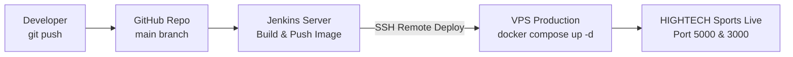

# SỔ TAY TOÀN TẬP: HƯỚNG DẪN TRIỂN KHAI HỆ THỐNG TRÊN VPS (PRODUCTION) & TỰ BIẾN VPS THÀNH RENDER CLOUD
## DỰ ÁN HIGHTECH SPORTS (ASP.NET CORE 8 + NEXT.JS 15 + SQL SERVER + JENKINS)

> **Mục tiêu:** Hướng dẫn từ A đến Z cách sở hữu và cấu hình một máy chủ ảo **VPS (Virtual Private Server)** riêng biệt để vận hành dự án, khắc phục triệt để nhược điểm của Render miễn phí (bị ngủ sau 15 phút, không có sẵn SQL Server). Đồng thời giới thiệu cách **biến VPS thành một nền tảng PaaS tự động hóa giống hệt Render (Coolify / Dokku)**.

---

## 1. SO SÁNH GIỮA RENDER CLOUD VÀ VPS RIÊNG

| Tiêu chí | Cloud Render.com (Free Tier) | VPS Riêng (Ubuntu Server) |
|---|---|---|
| **Chi phí** | Miễn phí (Free plan) | Khoảng 80.000đ - 150.000đ/tháng |
| **Cơ sở dữ liệu SQL Server** | ❌ Không hỗ trợ (chỉ có PostgreSQL) |  Tự do chạy SQL Server 2022 qua Docker |
| **Tốc độ & Độ trễ (Ping)** | Máy chủ nước ngoài (Mỹ, Singapore) | ⚡ Máy chủ đặt tại Việt Nam (Viettel, FPT, VNPT) |
| **Chế độ ngủ (Sleep Mode)** | 💤 Tự tắt sau 15 phút không có truy cập |  Hoạt động 24/7/365 liên tục |
| **Toàn quyền Quản trị (Root)** | ❌ Bị giới hạn hệ thống tệp |  Quyền root cao nhất, cài bất kỳ phần mềm nào |
| **Tên miền & SSL** | Cấp subdomain `.onrender.com` |  Tự do gắn tên miền riêng (`hightech.vn`) + SSL HTTPS |

---

## 2. CHUẨN BỊ MÁY CHỦ VPS

### 2.1 Cấu hình tối thiểu đề xuất
* **Hệ điều hành**: Ubuntu 22.04 LTS hoặc Ubuntu 24.04 LTS (x86_64).
* **CPU**: 2 Core vCPU.
* **RAM**: Tối thiểu 2GB (Khuyến nghị **4GB RAM** vì Microsoft SQL Server chiếm khoảng 1.5GB - 2GB RAM để chạy mượt).
* **Ổ cứng SSD**: 30GB - 50GB.
* **Nhà cung cấp uy tín tại VN / Quốc tế**: Vietnix, BKHost, TinoHost, CloudFly, DigitalOcean, Linode, Contabo.

### 2.2 Đăng nhập và cài đặt môi trường cơ sở
Mở Terminal trên máy tính (PowerShell hoặc Git Bash) và SSH vào VPS:
```bash
ssh root@<IP_VPS_CUA_BAN>
```

#### Bước 1: Cập nhật hệ điều hành
```bash
sudo apt update && sudo apt upgrade -y
sudo apt install -y curl wget git ufw ca-certificates gnupg
```

#### Bước 2: Cài đặt Docker & Docker Compose
```bash
# Cài đặt Docker Engine chính thức
curl -fsSL https://get.docker.com -o get-docker.sh
sudo sh get-docker.sh

# Bật Docker tự khởi động cùng hệ điều hành
sudo systemctl enable --now docker

# Kiểm tra Docker
docker --version
docker compose version
```

#### Bước 3: Mở các cổng Firewall (Tường lửa UFW)
```bash
sudo ufw allow 22/tcp    # Cổng SSH
sudo ufw allow 80/tcp    # Cổng Web HTTP
sudo ufw allow 443/tcp   # Cổng Web HTTPS
sudo ufw allow 8080/tcp  # Cổng Jenkins
sudo ufw allow 5000/tcp  # Cổng Backend API
sudo ufw allow 3000/tcp  # Cổng Frontend Next.js
sudo ufw enable
```

---

## 3. HAI PHƯƠNG ÁN TRIỂN KHAI TRÊN VPS

---

###  PHƯƠNG ÁN 1: DÙNG COOLIFY - BIẾN VPS THÀNH "RENDER RIÊNG CỦA BẠN" (KHUYÊN DÙNG NHẤT)

**Coolify** được mệnh danh là *"An open-source & self-hosted Heroku / Render alternative"*. Khi cài Coolify lên VPS:
* Bạn có một giao diện Dashboard web trực quan giống hệt Render.com.
* Tự động kết nối GitHub, mỗi lần bạn `git push`, VPS tự động build và deploy.
* Tự động cấp link HTTPS xanh mượt mà không cần cấu hình Nginx thủ công.
* Chạy không giới hạn số lượng dịch vụ và Database.

#### Bước 1: Cài đặt Coolify lên VPS chỉ bằng 1 dòng lệnh duy nhất
Trên Terminal VPS, chạy:
```bash
curl -fsSL https://cdn.coollabs.io/coolify/install.sh | bash
```
Quá trình cài đặt tự động diễn ra trong 2-3 phút.

#### Bước 2: Đăng nhập giao diện Coolify
1. Mở trình duyệt web truy cập: `http://<IP_VPS_CUA_BAN>:8000`
2. Đăng ký tài khoản Admin ban đầu.

#### Bước 3: Triển khai dự án Hightech Sports
1. Bấm **Create New Project** $\rightarrow$ Chọn **Production Environment**.
2. Bấm **+ Add New Resource** $\rightarrow$ Chọn **GitHub App** hoặc **Public Repository**.
3. Dán link repo của bạn: `https://github.com/LeTrongVanIT23D/hightech-frontend`.
4. Coolify sẽ tự nhận diện file `Dockerfile` và tệp mã nguồn.
5. Bấm **Deploy**: Hệ thống tự động đóng gói container, cấp URL truy cập trực tiếp!

---

### 🛠️ PHƯƠNG ÁN 2: DÙNG JENKINS TỰ ĐỘNG DEPLOY TRỰC TIẾP LÊN VPS QUA SSH

Nếu bạn muốn giữ nguyên quy trình CI/CD chuẩn doanh nghiệp với Jenkins:



#### Bước 1: Tạo cặp khóa SSH để Jenkins kết nối vào VPS
Trên máy chủ Jenkins (hoặc máy local):
```bash
ssh-keygen -t rsa -b 4096 -f ~/.ssh/id_rsa_vps -N ""
```
Copy public key sang VPS:
```bash
ssh-copy-id -i ~/.ssh/id_rsa_vps.pub root@<IP_VPS>
```

#### Bước 2: Tạo Credential trên giao diện Jenkins
1. Vào Jenkins $\rightarrow$ **Manage Jenkins** $\rightarrow$ **Credentials** $\rightarrow$ **System** $\rightarrow$ **Global credentials**.
2. Bấm **Add Credentials**:
   * **Kind**: `SSH Username with private key`.
   * **ID**: `vps-ssh-key`.
   * **Username**: `root`.
   * **Private Key**: Dán toàn bộ nội dung file `~/.ssh/id_rsa_vps`.
3. Bấm **Create**.

#### Bước 3: Cập nhật Stage Deploy trong `Jenkinsfile`
Trong `Jenkinsfile`, bạn bổ sung stage Deploy VPS như sau:

```groovy
stage('Deploy to VPS Production') {
    steps {
        echo "🚀 Đang triển khai mã nguồn lên VPS: ${env.SERVER_HOST}..."
        sshagent(['vps-ssh-key']) {
            sh """
            # 1. Tạo thư mục chứa project trên VPS nếu chưa có
            ssh -o StrictHostKeyChecking=no root@${SERVER_HOST} "mkdir -p /root/hightech-project"

            # 2. Đồng bộ file docker-compose lên VPS
            scp -o StrictHostKeyChecking=no backend/docker-compose.yml root@${SERVER_HOST}:/root/hightech-project/docker-compose.yml

            # 3. Kéo Image mới và khởi động trên VPS
            ssh -o StrictHostKeyChecking=no root@${SERVER_HOST} "cd /root/hightech-project && docker compose pull && docker compose down && docker compose up -d"
            """
        }
        echo "✅ Triển khai VPS thành công tại: http://${SERVER_HOST}:5000/swagger"
    }
}
```

---

## 4. CẤU HÌNH TÊN MIỀN RIÊNG VÀ SSL HTTPS (NGINX + CERTBOT)

Để trang web của bạn có đường dẫn đẹp như `https://api.hightech.vn` hoặc `https://hightechsports.store`:

### Bước 1: Trỏ DNS tên miền về IP của VPS
Vào trang quản lý tên miền (như Cloudflare, Namecheap, MatBao):
* Tạo bản ghi `A` với tên `@` $\rightarrow$ Trỏ về `<IP_VPS>`.
* Tạo bản ghi `A` với tên `api` $\rightarrow$ Trỏ về `<IP_VPS>`.

### Bước 2: Cài đặt Nginx làm Reverse Proxy trên VPS
```bash
sudo apt install -y nginx
```
Tạo file cấu hình cho hệ thống:
```bash
sudo nano /etc/nginx/sites-available/hightech.conf
```
Dán nội dung cấu hình:
```nginx
server {
    listen 80;
    server_name api.yourdomain.com; # Thay bằng tên miền của bạn

    location / {
        proxy_pass http://localhost:5000; # Chuyển tiếp tới Web API
        proxy_http_version 1.1;
        proxy_set_header Upgrade $http_upgrade;
        proxy_set_header Connection keep-alive;
        proxy_set_header Host $host;
        proxy_cache_bypass $http_upgrade;
        proxy_set_header X-Forwarded-For $proxy_add_x_forwarded_for;
        proxy_set_header X-Forwarded-Proto $scheme;
    }
}
```
Kích hoạt cấu hình và khởi động lại Nginx:
```bash
sudo ln -sf /etc/nginx/sites-available/hightech.conf /etc/nginx/sites-enabled/
sudo nginx -t
sudo systemctl restart nginx
```

### Bước 3: Cài đặt chứng chỉ SSL HTTPS Miễn phí vĩnh viễn (Let's Encrypt)
```bash
sudo apt install -y certbot python3-certbot-nginx
sudo certbot --nginx -d api.yourdomain.com
```
*Certbot sẽ tự động cấu hình HTTPS và tự động gia hạn khi chứng chỉ sắp hết hạn.*

---

## 5. TỔNG KẾT KIẾN TRÚC MỞ RỘNG TƯƠNG LAI

```text
                                 [ INTERNET ]
                                      |
                            [ Cloudflare / DNS ]
                                      |
                      [ VPS Production (Ubuntu 22.04) ]
                                      |
                         +------------+------------+
                         |  Nginx Reverse Proxy    |
                         |  (SSL Let's Encrypt)    |
                         +------------+------------+
                                      |
               +----------------------+----------------------+
               | (Port 3000)                                 | (Port 5000)
    [ Container Frontend Next.js ]               [ Container Backend Web API ]
                                                             |
                                                             | (Port 1433)
                                                 [ Container SQL Server 2022 ]
                                                             |
                                                 [ Persistent Docker Volume ]
```

Với mô hình này, hệ thống của bạn đạt chuẩn **Production Ready**, chạy 24/7 với hiệu năng tối đa, không phụ thuộc vào giới hạn của các dịch vụ Cloud miễn phí!
